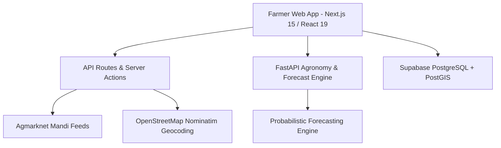

# 🌾 AgriPulse (किसानमित्र)

> **Next-Generation AI-Driven Smart Agriculture, Precision Soil Agronomy & Real-Time APMC Mandi Intelligence Platform**

[](https://nextjs.org/)
[](https://react.dev/)
[](https://www.typescriptlang.org/)
[](https://fastapi.tiangolo.com/)
[](https://supabase.com/)
[](https://tailwindcss.com/)

---

## 📌 Overview

**AgriPulse** is an end-to-end digital agricultural intelligence platform engineered to empower smallholder Indian farmers with actionable data-driven insights. From identifying optimal crops based on Soil Health Card lab metrics to calculating real-time APMC Mandi net realization (accounting for transportation freight, grade-wise pricing, and market arrivals), AgriPulse bridges the gap between agricultural technology and ground reality.

---

## ✨ Core Features

### 📍 1. Hyperlocal City & Taluka Search Engine
- **Dedicated Regional Database:** Pre-indexed catalog of 80+ agricultural talukas across Maharashtra, Karnataka, and adjoining regions (Kolhapur, Sangli, Satara, Pune, Solapur, Nashik, Belagavi, etc.).
- **Smart Autocomplete & Geocoding:** Instant taluka search with OpenStreetMap Nominatim fallback and district filter chips.
- **Scroll Isolation:** Zero background scroll chaining on mobile and desktop search dropdowns.

### 💰 2. Multi-Crop APMC Mandi Pricing & Arbitrage Engine
- **Dual Unit Modes:** Real-time conversion between standard wholesale units (**₹/quintal**) and retail farmgate units (**₹/kg**).
- **Comprehensive Quality Grading:** Displays **Grade A Premium Price**, **Modal Price**, and **Yesterday's Maximum Sell Price** across nearby mandis.
- **Net Realization Formula:**
  $$\text{Net Price} = \text{Modal Mandi Price} - (\text{Distance (km)} \times \text{Freight Rate (₹/km)})$$
- **Wide Crop Spectrum:** 25+ crops spanning vegetables, cash crops, grains, pulses, and fruits (Onion, Ladyfinger/Bhendi, Tomato, Soybean, Cotton, Sugarcane, Turmeric, Ginger, Wheat, Maize, etc.).

### 🧪 3. Scientific Soil Health & Crop Recommendation Engine
- **Soil Card Input:** Accepts Nitrogen ($N$), Phosphorus ($P$), Potassium ($K$), Soil pH, Clay percentage, and Organic Carbon ($OC$).
- **ICAR-Aligned Validation:** Automatic diagnosis of soil fertility indices with crop-specific suitability matching.
- **GPS-Based Soil Inference:** Auto-detects predominant soil textures (Black Cotton Soil, Red Loam, Laterite, Alluvial) based on farmer's GPS coordinates.

### 📈 4. 14-Day Probabilistic Price Forecasting
- **Quantile Predictions:** Displays $p_{10}$ (pessimistic), $p_{50}$ (expected modal), and $p_{90}$ (optimistic) price trajectory curves.
- **Hold vs. Sell Advisory:** AI calculates expected price trajectory against cold-storage depreciation to recommend whether to sell immediately or hold.

### 🌐 5. True Multilingual Localization
- Full trilingual support in **English**, **मराठी (Marathi)**, and **हिंदी (Hindi)**.
- Localized crop terminology (e.g., Ladyfinger $\to$ भेंडी $\to$ भिंडी).

### 💬 6. Multimodal Agronomist Assistant & WhatsApp Bot
- Context-aware agricultural assistant powered by AI.
- WhatsApp integration ready via direct `wa.me` webhook integration.

---

## 🏗 Architecture & Tech Stack



- **Frontend:** Next.js 15 (Turbopack, App Router), React 19, TypeScript, Tailwind CSS, Lucide Icons.
- **Backend:** Python FastAPI, Pydantic, NumPy/SciPy statistical models.
- **Database:** Supabase (PostgreSQL 15 with Row-Level Security and PostGIS extensions).
- **APIs:** Agmarknet (Data.gov.in), OpenStreetMap Nominatim API.

---

## 📁 Repository Structure

```
AgriPulse/
├── api/                    # Python FastAPI microservices (forecasting & agronomist engine)
│   ├── main.py             # FastAPI entrypoint and REST endpoints
│   └── requirements.txt    # Python dependencies
├── packages/               # Shared TypeScript libraries
│   └── shared/             # API client, types, mock data, and utilities
├── supabase/               # Database migrations and seed datasets
│   ├── migrations/         # 001_initial_schema.sql
│   └── seed.sql            # Comprehensive APMC mandis & crop seed data
├── web/                    # Next.js 15 Web Application
│   ├── app/                # App router pages (dashboard, markets, soil, chat, etc.)
│   ├── components/         # Reusable UI components (Navbar, Footer, etc.)
│   ├── lib/                # Business logic (geoService, location, i18n, etc.)
│   └── public/             # Static assets and icons
├── .gitignore              # Git ignore rules
└── README.md               # Project documentation
```

---

## 🚀 Getting Started

### Prerequisites
- **Node.js** 18.18+ or 20+
- **Python** 3.10+ (for FastAPI backend)
- **npm** or **pnpm** / **yarn**

### 1. Clone the Repository
```bash
git clone https://github.com/YashNawal/AgriPulse.git
cd AgriPulse
```

### 2. Frontend Setup (Next.js)
```bash
cd web
npm install

# Configure environment variables
cp .env.example .env.local

# Run the local development server
npm run dev
```
Open [http://localhost:3000](http://localhost:3000) in your browser.

### 3. Backend Setup (FastAPI - Optional)
```bash
cd ../api
python -m venv venv
source venv/bin/activate  # On Windows: venv\Scripts\activate
pip install -r requirements.txt
uvicorn main:app --reload --port 8000
```

---

## 📜 Academic Project Information

- **Project Title:** AgriPulse (किसानमित्र) — AI-Driven Smart Agriculture & APMC Mandi Decision Platform
- **Domain:** Artificial Intelligence, Geospatial Information Systems (GIS), Agritech
- **Target Audience:** Indian Farmers, FPOs (Farmer Producer Organizations), APMC Mandi Traders

---

## 📄 License
This project is developed as an academic final-year capstone project and open public good for the farming community.
